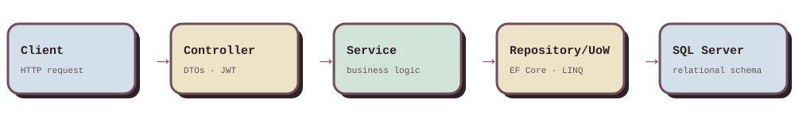

  
  

 

### 👋 Hi, I'm Somaya

Backend .NET developer who turns business requirements into clean, reliable APIs that are easy to read, maintain, and grow.

- 🧩 **What I build:** RESTful APIs and backend systems with ASP.NET Core, C#, and SQL Server
- 🧱 **How I build:** Clean Architecture, Dependency Injection, Repository Pattern, and Unit of Work
- 🔐 **Security & data:** JWT authentication, role-based authorization, and well-designed relational databases with EF Core
- 🔍 **How I work:** I start from the business problem, break it down, and ship a practical solution
- 🎓 B.Sc. Computer Science &amp; IT, Tanta University (2026) · 📍 Tanta, Egypt

 

  

## 🛠️ Stack

## 🧱 How I structure backends

  

## 🔌 APIs I design

Sample endpoints showing the REST conventions I follow: JWT auth, pagination, role-based access, and proper status codes.

| Method | Endpoint | What it does | Status |
|---|---|---|---|
| `POST` | `/api/auth/login` | Authenticate and issue a JWT | `200` `401` |
| `GET` | `/api/products?page=1&pageSize=12` | Filtered, paginated list | `200` |
| `GET` | `/api/products/{id}` | Fetch a single item | `200` `404` |
| `POST` | `/api/products` | Create (Admin only) | `201` `403` |
| `DELETE` | `/api/products/{id}` | Remove (Admin only) | `204` |

## 🚀 Projects

  
  
  

  <b>Waneesy</b>: <a href="https://github.com/Somaya-Mohamed/GP-Waneesy-Backend">Code</a> · <a href="https://motherdashboard.vercel.app/login">Live Demo</a>
  &nbsp;&nbsp;|&nbsp;&nbsp;
  <b>Masaq</b>: <a href="https://github.com/Somaya-Mohamed/Masaq_DEPI">Code</a> · <a href="https://masaaq.netlify.app/">Live Demo</a>
  &nbsp;&nbsp;|&nbsp;&nbsp;
  <b>Yodneen</b>: <a href="https://github.com/Somaya-Mohamed/yodneen-clothes-store-api">Code</a> · <a href="https://my-store-project-834m.vercel.app/home">Live Demo</a>

---

**Let's build something reliable.** Open to backend .NET roles and freelance work.

✉️ somaya.m.mohamed1@gmail.com

