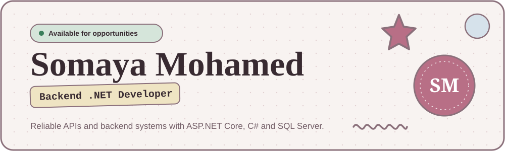
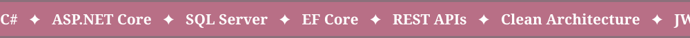
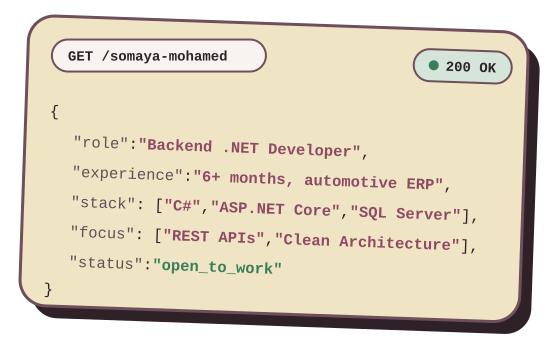
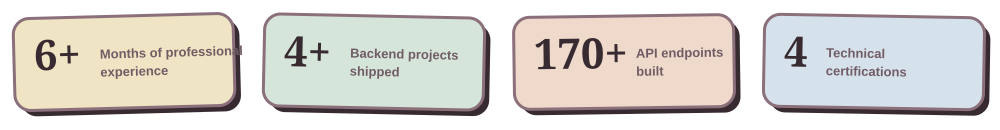
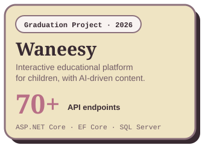
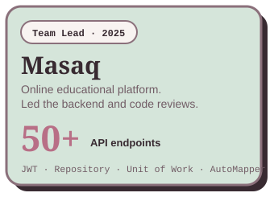
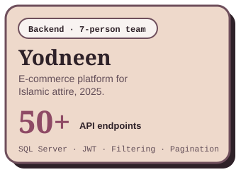

  
  

 

### 👋 Hi, I'm Somaya

I turn real ERP business workflows and client requirements into practical, working backend software.

- 🚗 Built backend features for **4S Plus**, a SaaS automotive ERP, at Al Manar Technology
- 🧱 I like **Clean Architecture**, clear APIs, and databases that stay fast
- 🎓 B.Sc. Computer Science &amp; IT, Tanta University (2026)
- 📍 Tanta, Egypt

 

  

## 🛠️ Stack

## 🚀 Projects

  
  
  

  <b>Waneesy</b>: <a href="https://github.com/Somaya-Mohamed/GP-Waneesy-Backend">Code</a> · <a href="https://motherdashboard.vercel.app/login">Live Demo</a>
  &nbsp;&nbsp;|&nbsp;&nbsp;
  <b>Masaq</b>: <a href="https://github.com/Somaya-Mohamed/Masaq_DEPI">Code</a> · <a href="https://masaaq.netlify.app/">Live Demo</a>
  &nbsp;&nbsp;|&nbsp;&nbsp;
  <b>Yodneen</b>: <a href="https://github.com/Somaya-Mohamed/yodneen-clothes-store-api">Code</a> · <a href="https://my-store-project-834m.vercel.app/home">Live Demo</a>

---

**Let's build something reliable.** Open to backend .NET roles and freelance work.

✉️ somaya.m.mohamed1@gmail.com

